# ERD محدّث — Maggadit Food Industries System

## Entity Relationship Diagram (Mermaid)

```mermaid
erDiagram
    %% Core Entities
    ORGANIZATION ||--o{ WAREHOUSE : ""
    ORGANIZATION ||--o{ VEHICLE : ""
    ORGANIZATION ||--o{ AREA : ""
    ORGANIZATION ||--o{ PACKAGE_STATUS : ""
    ORGANIZATION ||--o{ DEVICE : ""
    ORGANIZATION ||--o{ CONTACT_MESSAGE : ""
    ORGANIZATION ||--o{ USER : ""
    ORGANIZATION {
        int id PK
        string name
        string code
        int parent_id FK
        string organization_type
    }

    ORGANIZATION ||--o{ CUSTOMER_ORGANIZATION : ""
    CUSTOMER ||--o{ CUSTOMER_ORGANIZATION : ""
    CUSTOMER ||--o{ CUSTOMER_FAVORITE : ""
    CUSTOMER ||--o{ CUSTOMER_PRICE_LIST : ""
    CUSTOMER ||--o{ CUSTOMER_WALLET : ""

    CUSTOMER {
        int id PK
        string name
        string username
        string email
        string password
        string customer_type
        decimal credit_limit
        decimal current_balance
        int payment_terms_days
        boolean wallet_enabled
    }

    %% Product Entities
    ITEM }|--|| ITEM_TYPE : ""
    ITEM }|--|| CATEGORY : ""
    ITEM }|--|| BRAND : ""
    ITEM }|--|| ITEM_MODEL : ""
    ITEM }|--|| VENDOR : ""
    ITEM ||--o{ ITEM_PACK : ""
    ITEM ||--o{ ITEM_IMAGE : ""

    ITEM {
        int id PK
        string code
        string name_en
        string name_ar
    }

    ITEM_PACK }|--|| ITEM : ""
    ITEM_PACK }|--|| UOM : ""
    ITEM_PACK }|--|| WAREHOUSE : ""
    ITEM_PACK ||--o{ ORDER_ITEM : ""
    ITEM_PACK ||--o{ INVOICE_ITEM : ""
    ITEM_PACK ||--o{ QUOTATION_ITEM : ""
    ITEM_PACK ||--o{ RETURN_ITEM : ""
    ITEM_PACK ||--o{ BATCH_ITEM : ""
    ITEM_PACK ||--o{ INVENTORY : ""

    ITEM_PACK {
        int id PK
        int item_id FK
    }

    %% Sales Flow
    CUSTOMER ||--o{ ORDER : ""
    WAREHOUSE ||--o{ ORDER : ""
    ORDER ||--o{ ORDER_ITEM : ""
    ORDER ||--o{ ORDER_STATUS_HISTORY : ""
    ORDER ||--o{ QUOTATION : ""
    ORDER ||--o{ INVOICE : ""
    ORDER ||--o{ DELIVERY : ""

    ORDER {
        int id PK
        string order_number
        int customer_id FK
        int warehouse_id FK
        string status
    }

    ORDER_ITEM }|--|| ORDER : ""
    ORDER_ITEM }|--|| ITEM : ""

    QUOTATION }|--|| ORDER : ""
    QUOTATION ||--o{ QUOTATION_ITEM : ""
    QUOTATION }|--|| CURRENCY : ""

    QUOTATION_ITEM }|--|| QUOTATION : ""
    QUOTATION_ITEM }|--|| ITEM : ""
    QUOTATION_ITEM }|--|| ITEM_PACK : ""

    INVOICE }|--|| CUSTOMER : ""
    INVOICE }|--|| ORDER : ""
    INVOICE }|--|| QUOTATION : ""
    INVOICE }|--|| PRICE_LIST : ""
    INVOICE }|--|| CURRENCY : ""
    INVOICE ||--o{ INVOICE_ITEM : ""
    INVOICE ||--o{ DELIVERY : ""
    INVOICE ||--o{ RETURN_REQUEST : ""
    INVOICE ||--o{ CREDIT_NOTE : ""
    INVOICE }|--|| USER : ""

    INVOICE {
        int id PK
        string invoice_number
        int customer_id FK
        int order_id FK
        int quotation_id FK
        string payment_type
        int currency_id FK
        string status
        timestamp approved_at
        timestamp payment_deadline_at
    }

    INVOICE_ITEM }|--|| INVOICE : ""
    INVOICE_ITEM }|--|| ITEM : ""
    INVOICE_ITEM }|--|| ITEM_PACK : ""
    INVOICE_ITEM }|--|| WAREHOUSE : ""
    INVOICE_ITEM }|--|| BATCH_ITEM : ""
    INVOICE_ITEM }|--|| PRICE_LIST_ITEM : ""
    INVOICE_ITEM }|--|| CURRENCY : ""
    INVOICE_ITEM ||--o{ RETURN_ITEM : ""

    %% Returns
    RETURN_REQUEST }|--|| INVOICE : ""
    RETURN_REQUEST }|--|| CUSTOMER : ""
    RETURN_REQUEST ||--o{ RETURN_ITEM : ""
    RETURN_REQUEST }|--|| USER : ""
    RETURN_REQUEST ||--o{ CREDIT_NOTE : ""

    RETURN_ITEM }|--|| RETURN_REQUEST : ""
    RETURN_ITEM }|--|| INVOICE_ITEM : ""
    RETURN_ITEM }|--|| ITEM : ""
    RETURN_ITEM }|--|| ITEM_PACK : ""
    RETURN_ITEM }|--|| BATCH_ITEM : ""

    CREDIT_NOTE }|--|| RETURN_REQUEST : ""
    CREDIT_NOTE }|--|| CUSTOMER : ""
    CREDIT_NOTE }|--|| INVOICE : ""
    CREDIT_NOTE }|--|| CURRENCY : ""

    %% Deliveries
    DELIVERY }|--|| INVOICE : ""
    DELIVERY }|--|| ORDER : ""
    DELIVERY }|--|| CUSTOMER : ""
    DELIVERY }|--|| VEHICLE : ""
    DELIVERY }|--|| USER : ""
    DELIVERY ||--o{ DELIVERY_STAGE_LOG : ""

    DELIVERY {
        int id PK
        string current_stage
    }

    DELIVERY_STAGE_LOG }|--|| DELIVERY : ""
    DELIVERY_STAGE_LOG }|--|| USER : ""

    %% Inventory
    ITEM ||--o{ INVENTORY : ""
    ITEM_PACK ||--o{ INVENTORY : ""
    WAREHOUSE ||--o{ INVENTORY : ""
    INVENTORY ||--o{ INVENTORY_MOVEMENT : ""
    INVENTORY ||--o{ STOCK_RESERVATION : ""

    INVENTORY {
        int id PK
        int item_id FK
        int item_pack_id FK
        int warehouse_id FK
        decimal quantity_on_hand
        decimal reserved_quantity
    }

    INVENTORY_MOVEMENT }|--|| ITEM : ""
    INVENTORY_MOVEMENT }|--|| ITEM_PACK : ""
    INVENTORY_MOVEMENT }|--|| WAREHOUSE : ""
    INVENTORY_MOVEMENT }|--|| BATCH_ITEM : ""
    INVENTORY_MOVEMENT }|--|| USER : ""

    STOCK_RESERVATION }|--|| ITEM : ""
    STOCK_RESERVATION }|--|| ITEM_PACK : ""
    STOCK_RESERVATION }|--|| WAREHOUSE : ""

    %% Batch/Exp tracking
    PRODUCTION_BATCH ||--o{ BATCH_ITEM : ""
    ITEM ||--o{ BATCH_ITEM : ""

    BATCH_ITEM {
        int id PK
        int batch_id FK
        int item_id FK
        int item_pack_id FK
        date expiry_date
    }

    BATCH_ITEM ||--o{ BATCH_ITEM_STOCK : ""
    BATCH_ITEM ||--o{ BATCH_MOVEMENT : ""

    BATCH_ITEM_STOCK }|--|| BATCH_ITEM : ""
    BATCH_ITEM_STOCK }|--|| WAREHOUSE : ""

    %% Pricing
    PRICE_LIST ||--o{ PRICE_LIST_VERSION : ""
    PRICE_LIST_VERSION ||--o{ PRICE_LIST_VERSION_ITEM : ""
    ITEM ||--o{ PRICE_LIST_VERSION_ITEM : ""
    ITEM_PACK ||--o{ PRICE_LIST_VERSION_ITEM : ""
    PRICE_LIST_VERSION_ITEM }|--|| CURRENCY : ""

    PRICE_LIST ||--o{ PRICE_LIST_ITEM : ""
    PRICE_LIST ||--o{ CUSTOMER_PRICE_LIST : ""
    CUSTOMER ||--o{ CUSTOMER_PRICE_LIST : ""
    CUSTOMER_PRICE_LIST }|--|| USER : ""

    CUSTOMER ||--o{ CUSTOMER_WALLET : ""
    CURRENCY ||--o{ CUSTOMER_WALLET : ""
    CUSTOMER_WALLET ||--o{ WALLET_TRANSACTION : ""
    CURRENCY ||--o{ WALLET_TRANSACTION : ""

    %% Payments
    INVOICE ||--o{ PAYMENT : ""
    CUSTOMER ||--o{ PAYMENT : ""
    CURRENCY ||--o{ PAYMENT : ""
    USER ||--o{ PAYMENT : ""

    %% Audit
    AUDIT_LOG }|--|| USER : ""
```

---

## Entity Summary

### Core Entities
| Entity | Purpose | PK | FK References |
|--------|---------|-----|---------------|
| `organizations` | Multi-level org structure | `id` | self(parent_id) |
| `customers` | User accounts | `id` | `price_list_id` |
| `users` | Staff/admin accounts | `id` | `organization_id` |

### Product Entities
| Entity | Purpose | PK | FK References |
|--------|---------|-----|---------------|
| `items` | Products | `id` | item_type_id, category_id, brand_id, model_id, supplier_id |
| `item_types` | Item classification | `id` | - |
| `categories` | Product categories | `id` | - |
| `brands` | Product brands | `id` | - |
| `item_models` | Item model/specs | `id` | - |
| `uoms` | Units of measure | `id` | - |
| `vendors` | Suppliers | `id` | - |
| `item_packs` | Pack configurations | `id` | item_id, uom_id, warehouse_id, pack_type_id, pack_capacity_id |
| `item_images` | Product images | `id` | item_id |
| `pack_types` | Pack type classification | `id` | - |
| `pack_capacities` | Pack capacity specs | `id` | uom_id |

### Sales Flow Entities
| Entity | Purpose | PK | FK References |
|--------|---------|-----|---------------|
| `orders` | Sales orders | `id` | customer_id, warehouse_id, price_list_snapshot_id, currency_id, created_by |
| `order_items` | Order line items | `id` | order_id, item_id, item_pack_id, price_list_item_id |
| `order_status_histories` | Order status changes | `id` | order_id, changed_by |
| `quotations` | Customer quotations | `id` | order_id, currency_id, created_by |
| `quotation_items` | Quotation line items | `id` | quotation_id, item_id, item_pack_id |
| `invoices` | Final invoices | `id` | customer_id, order_id, quotation_id, currency_id, approved_by, price_list_id |
| `invoice_items` | Invoice line items | `id` | invoice_id, item_id, item_pack_id, warehouse_id, batch_item_id, price_list_item_id, currency_id |
| `invoice_item_batches` | FEFO batch allocation | `id` | invoice_item_id, batch_item_id |

### Return & Credit Entities
| Entity | Purpose | PK | FK References |
|--------|---------|-----|---------------|
| `return_requests` | Return requests | `id` | invoice_id, customer_id, requested_by, reviewed_by |
| `return_items` | Return line items | `id` | return_request_id, invoice_item_id, item_id, item_pack_id, batch_item_id |
| `credit_notes` | Credit notes | `id` | return_request_id, customer_id, applied_to_invoice_id, currency_id |

### Delivery Entities
| Entity | Purpose | PK | FK References |
|--------|---------|-----|---------------|
| `deliveries` | Delivery tracking | `id` | invoice_id, order_id, customer_id, vehicle_id, driver_id |
| `delivery_stage_logs` | Delivery stage history | `id` | delivery_id, updated_by |

### Inventory Entities
| Entity | Purpose | PK | FK References |
|--------|---------|-----|---------------|
| `inventories` | Aggregated stock | `id` | item_id, item_pack_id, warehouse_id |
| `inventory_movements` | Stock audit trail | `id` | inventory_id, item_id, item_pack_id, warehouse_id, batch_item_id, created_by |
| `stock_reservations` | Pre-sale reservations | `id` | item_id, item_pack_id, warehouse_id |
| `production_batches` | Batch headers | `id` | - |
| `batch_items` | Batch line items | `id` | batch_id, item_id, item_pack_id |
| `batch_item_stock` | Batch warehouse stock | `id` | batch_item_id, warehouse_id |
| `batch_movements` | Batch warehouse transfers | `id` | batch_item_id, from_warehouse_id, to_warehouse_id |

### Pricing Entities
| Entity | Purpose | PK | FK References |
|--------|---------|-----|---------------|
| `price_lists` | Price list definitions | `id` | created_by |
| `price_list_versions` | Price list versions | `id` | price_list_id, created_by |
| `price_list_version_items` | Version price items | `id` | price_list_version_id, item_id, item_pack_id, currency_id |
| `price_list_items` | Direct price items | `id` | price_list_id, item_id, created_by |
| `customer_price_lists` | Customer ↔ PriceList history | `id` | customer_id, price_list_id, assigned_by |

### Wallet & Payment Entities
| Entity | Purpose | PK | FK References |
|--------|---------|-----|---------------|
| `customer_wallets` | Customer wallets | `id` | customer_id (unique), currency_id |
| `wallet_transactions` | Wallet transaction log | `id` | wallet_id, currency_id, created_by |
| `payments` | Payment records | `id` | invoice_id, customer_id, currency_id, received_by |
| `payment_deadline_settings` | Payment deadline config | `id` | updated_by |

### Audit & Metadata Entities
| Entity | Purpose | PK | FK References |
|--------|---------|-----|---------------|
| `audit_logs` | Audit trail | `id` | user_id (polymorphic) |

### System Entities (Kept from existing)
| Entity | Purpose | PK | FK References |
|--------|---------|-----|---------------|
| `currencies` | Currency definitions | `id` | - |
| `countries` | Countries | `id` | - |
| `states` | States/provinces | `id` | country_id |
| `cities` | Cities | `id` | state_id |
| `areas` | Geographic areas | `id` | organization_id, city_id, state_id |
| `vehicles` | Delivery vehicles | `id` | organization_id, vehicle_type_id |
| `vehicle_types` | Vehicle types | `id` | - |
| `warehouse_types` | Warehouse types | `id` | - |
| `warehouse_warehouse_type` | pivot | - | - |
| `package_statuses` | Package statuses | `id` | organization_id |
| `sales_order_types` | Order type classification | `id` | - |
| `offers` | Promotional offers | `id` | item_id, item_pack_id, price_list_id |
| `notifications` | System notifications | `id` | - |
| `notification_reads` | Notification read tracking | `id` | notification_id, customer_id |
| `devices` | Customer devices (FCM) | `id` | organization_id |
| `contact_messages` | Contact form messages | `id` | organization_id |
| `surveys`, `survey_questions`, `survey_responses`, `survey_answers` | Survey system | varies | - |
| `organization_about` | Org about page | `id` | organization_id |
| `banners` | Promotional banners | `id` | - |
| `faqs` | FAQ entries | `id` | - |
| `privacy_policies` | Privacy content | `id` | - |

### Deleted Entities (PackDefinition ecosystem)
| Entity | Status | Reason |
|--------|--------|--------|
| `pack_definitions` | ❌ Deleted | Merged into ItemPack |
| `pack_definition_pack_operation` | ❌ Deleted | Pivot no longer needed |
| `pack_definition_pack_group` | ❌ Deleted | Pivot no longer needed |

### Retained (but unlinked from PackDefinition)
| Entity | Status | New Owner |
|--------|--------|-----------|
| `pack_operations` | ✅ Kept | Can be linked to ItemPack if needed |
| `pack_groups` | ✅ Kept | Can be linked to ItemPack if needed |
| `item_pack_pack_operation` | ✅ Kept | Still valid, used by ItemPack |
| `item_pack_pack_group` | ✅ Kept | Still valid, used by ItemPack |

---

## Relationship Summary (by cardinality)

### 1:N Relationships
- Organization → 1:N → Warehouses, Vehicles, Areas, Users, PackageStatuses, Devices, ContactMessages
- Customer → 1:N → Orders, Invoices, ReturnRequests, CustomerWallets, Payments
- Item → 1:N → ItemPacks, Orders, InvoiceItems, QuotationItems, BatchItems
- Invoice → 1:N → InvoiceItems, CreditNotes, Payments, Returns
- Order → 1:N → OrderItems, OrderStatusHistories, Quotations, Invoices, Deliveries
- ReturnRequest → 1:N → ReturnItems

### N:M Relationships
- Customer ↔ Organization (via `customer_organization` pivot)
- Customer ↔ Notification (via `notification_reads` pivot)
- Customer ↔ PriceList (via `customer_price_lists`)
- Item ↔ Category, Brand, ItemType, ItemModel, Vendor (via FK)
- InvoiceItem ↔ Batch (via `invoice_item_batches` pivot)
- ItemPack ↔ PackOperation (via `item_pack_pack_operation` pivot)
- ItemPack ↔ PackGroup (via `item_pack_pack_group` pivot)

---

## Key Design Decisions

1. **Single Source of Truth for Pricing**: `CustomerPriceList` links customers to their price lists. The `PricingService` uses this to resolve prices, falling back to default `PriceList`.

2. **FEFO Batch Allocation**: The `InventoryService.commit()` method allocates stock from `BatchItemStock` records ordered by `expiry_date ASC`. Allocations are stored in `invoice_item_batches` pivot.

3. **Stock Reservation Workflow**:
   - Order created → StockReservation created (reserves stock)
   - Invoice approved → Stock committed (FEFO allocation) + reservation consumed
   - Order cancelled/expired → StockReservation released + inventory adjusted

4. **Multi-Currency**: All monetary entities (`orders`, `quotations`, `invoices`, `invoice_items`, `payments`, `credit_notes`, `customer_wallets`, `wallet_transactions`) carry `currency_id` + `exchange_rate` snapshot.

5. **Wallet Integration**: Customer wallet is linked to invoice payment via `payment_method = wallet`. Funds are deducted atomically during invoice approval.

6. **Audit Trail**: `AuditLog` records events on key entities via Eloquent Observers.

---

## Indexes & Constraints

### orders
| Column(s) | Type | Description |
|-----------|------|-------------|
| `order_number` | UNIQUE | Unique order identifier |
| `customer_id, status` | INDEX | Lookup orders by customer and status |
| `status, created_at` | INDEX | Lookup by status and creation order |

### order_items
| Column(s) | Type | Description |
|-----------|------|-------------|
| `order_id` | INDEX | Foreign key lookup |
| `item_id` | INDEX | Foreign key lookup |
| `item_pack_id` | INDEX | Foreign key lookup |

### order_status_histories
| Column(s) | Type | Description |
|-----------|------|-------------|
| `order_id, created_at` | INDEX | History timeline |

### quotations
| Column(s) | Type | Description |
|-----------|------|-------------|
| `order_id` | INDEX | Foreign key lookup |
| `currency_id` | INDEX | Foreign key lookup |

### quotation_items
| Column(s) | Type | Description |
|-----------|------|-------------|
| `quotation_id` | INDEX | Foreign key lookup |

### invoices
| Column(s) | Type | Description |
|-----------|------|-------------|
| `invoice_number` | UNIQUE | Unique invoice identifier |
| `customer_id` | INDEX | Foreign key lookup |
| `order_id` | INDEX | Foreign key lookup |
| `quotation_id` | INDEX | Foreign key lookup |
| `status` | INDEX | Lookup by status |
| `currency_id` | INDEX | Foreign key lookup |
| `status, payment_deadline_at` | INDEX | Find expired invoices (scheduler) |
| `approved_by` | INDEX | Foreign key lookup |
| `CHECK: payment_type` | CHECK | Must be 'cash' or 'credit' |
| `CHECK: status` | CHECK | Must be valid InvoiceStatus |

### invoice_items
| Column(s) | Type | Description |
|-----------|------|-------------|
| `invoice_id` | INDEX | Foreign key lookup |
| `item_id` | INDEX | Foreign key lookup |
| `item_pack_id` | INDEX | Foreign key lookup |
| `batch_item_id` | INDEX | FEFO allocation lookup |
| `warehouse_id` | INDEX | Foreign key lookup |

### invoice_item_batches
| Column(s) | Type | Description |
|-----------|------|-------------|
| `invoice_item_id` | INDEX | Foreign key lookup |
| `batch_item_id` | INDEX | FEFO batch lookup |

### deliveries
| Column(s) | Type | Description |
|-----------|------|-------------|
| `invoice_id` | INDEX | Foreign key lookup |
| `order_id` | INDEX | Foreign key lookup |
| `customer_id` | INDEX | Foreign key lookup |
| `vehicle_id` | INDEX | Foreign key lookup |
| `driver_id` | INDEX | Foreign key lookup |

### delivery_stage_logs
| Column(s) | Type | Description |
|-----------|------|-------------|
| `delivery_id, created_at` | INDEX | Timeline lookup |

### return_requests
| Column(s) | Type | Description |
|-----------|------|-------------|
| `return_number` | UNIQUE | Unique return identifier |
| `invoice_id` | INDEX | Foreign key lookup |
| `customer_id` | INDEX | Foreign key lookup |
| `status` | INDEX | Lookup by status |

### return_items
| Column(s) | Type | Description |
|-----------|------|-------------|
| `return_request_id` | INDEX | Foreign key lookup |
| `invoice_item_id` | INDEX | Foreign key lookup |
| `item_id` | INDEX | Foreign key lookup |
| `batch_item_id` | INDEX | FEFO batch lookup |

### credit_notes
| Column(s) | Type | Description |
|-----------|------|-------------|
| `credit_note_number` | UNIQUE | Unique credit note identifier |
| `return_request_id` | INDEX | Foreign key lookup |
| `customer_id` | INDEX | Foreign key lookup |
| `currency_id` | INDEX | Foreign key lookup |
| `applied_to_invoice_id` | INDEX | Foreign key lookup |

### inventories
| Column(s) | Type | Description |
|-----------|------|-------------|
| `item_id, item_pack_id, warehouse_id` | UNIQUE | Prevent duplicate inventory records |

### inventory_movements
| Column(s) | Type | Description |
|-----------|------|-------------|
| `item_id, warehouse_id, created_at` | INDEX | Movement timeline by item/warehouse |
| `inventory_id` | INDEX | Foreign key lookup |
| `batch_item_id` | INDEX | FEFO batch lookup |
| `type` | INDEX | Filter by movement type |
| `reference_type, reference_id` | INDEX | Polymorphic reference lookup |

### stock_reservations
| Column(s) | Type | Description |
|-----------|------|-------------|
| `item_id, item_pack_id, warehouse_id` | INDEX | Lookup reservations by product |
| `status` | INDEX | Filter by status |
| `expires_at` | INDEX | Find expired reservations (scheduler) |
| `reserved_for_type, reserved_for_id` | INDEX | Polymorphic reference lookup |
| `CHECK: status` | CHECK | Must be 'active', 'consumed', 'released', 'expired' |

### payment_deadline_settings
| Column(s) | Type | Description |
|-----------|------|-------------|
| `payment_type` | INDEX | Filter by payment type |
| `CHECK: payment_type` | CHECK | Must be 'cash' or 'credit' |
| `CHECK: applies_to` | CHECK | Must be 'all' or 'specific_customers' |

### customer_wallets
| Column(s) | Type | Description |
|-----------|------|-------------|
| `customer_id` | UNIQUE | One wallet per customer (first currency) |
| `currency_id` | INDEX | Foreign key lookup |

### wallet_transactions
| Column(s) | Type | Description |
|-----------|------|-------------|
| `wallet_id` | INDEX | Foreign key lookup |
| `type` | INDEX | Filter by transaction type |
| `reference_type, reference_id` | INDEX | Polymorphic reference lookup |
| `CHECK: type` | CHECK | Must be 'deposit', 'purchase', 'refund', 'withdrawal', 'adjustment' |
| `CHECK: method` | CHECK | Must be 'cash', 'bank_transfer', 'cheque', 'online' |

### payments
| Column(s) | Type | Description |
|-----------|------|-------------|
| `payment_number` | UNIQUE | Unique payment identifier |
| `invoice_id` | INDEX | Foreign key lookup |
| `customer_id` | INDEX | Foreign key lookup |
| `currency_id` | INDEX | Foreign key lookup |
| `received_by` | INDEX | Foreign key lookup |
| `CHECK: method` | CHECK | Must be 'cash', 'bank_transfer', 'cheque', 'online', 'wallet' |

### audit_logs
| Column(s) | Type | Description |
|-----------|------|-------------|
| `auditable_type, auditable_id` | INDEX | Polymorphic lookup |
| `created_at` | INDEX | Timeline lookup |

### customer_price_lists
| Column(s) | Type | Description |
|-----------|------|-------------|
| `customer_id, price_list_id` | UNIQUE | Prevent duplicate assignments |
| `is_active` | INDEX | Filter active assignments |

### price_lists
| Column(s) | Type | Description |
|-----------|------|-------------|
| `currency_id` | INDEX | Foreign key lookup |
| `is_default` | INDEX | Find default price list |

### batch_items
| Column(s) | Type | Description |
|-----------|------|-------------|
| `batch_id, item_id, item_pack_id` | UNIQUE | Prevent duplicate batch items |
| `expiry_date` | INDEX | FEFO ordering |

### batch_item_stock
| Column(s) | Type | Description |
|-----------|------|-------------|
| `batch_item_id, warehouse_id` | INDEX | Stock location lookup |

### customers
| Column(s) | Type | Description |
|-----------|------|-------------|
| `CHECK: customer_type` | CHECK | Must be 'cash' or 'credit' |

---

*Generated: 2026-09-17*
